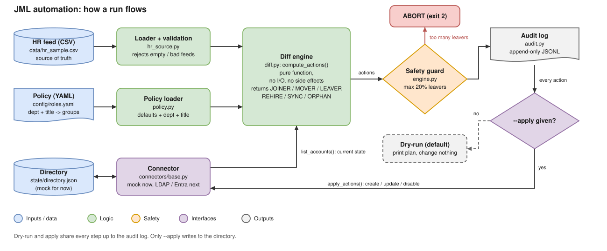
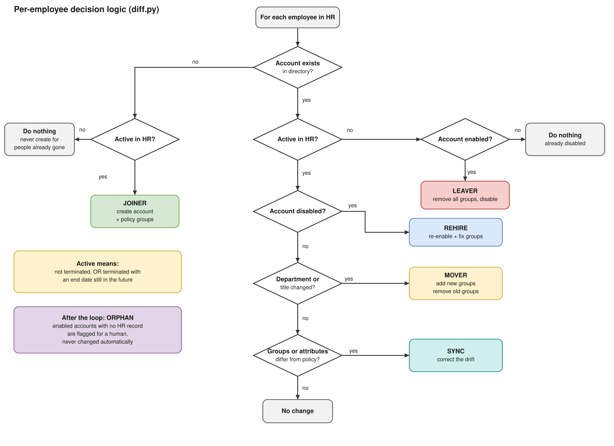

# JML Automation


HR-driven **Joiner / Mover / Leaver** identity lifecycle automation in Python.
HR is the source of truth. Directory access follows HR data automatically, with a
dry-run mode, a safety guard, and an audit trail.

## The problem

Manual account management fails in two predictable ways: new hires wait days for
access, and people who change roles or leave **keep access they should no longer have**
(privilege creep, orphaned accounts). Most IAM audit findings come from the mover and
leaver steps, not the joiner step.

## The idea in one paragraph

There are two lists. One says **what should be true** (the HR feed: who works here, in which
department, in which role). The other says **what is true** (the directory: which accounts exist and
what they can access). This tool compares the two and makes the directory match HR. A policy file
translates job roles into access, so HR never has to say "give her GitHub access", only
"she is a Software Engineer in Engineering".

## How a run flows



| Step | Component | What it does |
|---|---|---|
| 1 | `hr_source.py` | Loads the HR CSV. Rejects duplicate IDs, bad statuses, bad emails, and empty files. |
| 2 | `policy.py` | Loads `config/roles.yaml` and works out which groups a department and title should have. |
| 3 | `connectors/` | Reads the current directory through a connector interface (mock JSON now, LDAP and Entra next). |
| 4 | `diff.py` | Compares HR with the directory and returns a list of actions. A pure function with no side effects. |
| 5 | `engine.py` | Safety guard: aborts if too many accounts would be disabled in one run. |
| 6 | `audit.py` | Writes every planned action to an append-only log, dry-run included. |
| 7 | `engine.py` | Only with `--apply`: executes the actions through the connector and saves. |

Dry-run and apply share steps 1 to 6, so the dry-run output is exactly what `--apply` would do.

## The three inputs

| Input | File | Meaning |
|---|---|---|
| HR feed | `data/hr_sample.csv` | The source of truth about people |
| Policy | `config/roles.yaml` | The rulebook: department + title becomes groups |
| Directory | `state/directory.json` | What exists now (stands in for LDAP or Entra ID) |

A user's groups are the **default groups + their department's groups + their title's groups**.
For a Software Engineer in Engineering that is:

```
all-staff (default) + eng-all + github-users (Engineering) + dev-tools (Software Engineer)
```

## Decision logic



| Event | Trigger | Action |
|---|---|---|
| **Joiner** | In HR, no account | Create the account and assign groups from policy |
| **Mover** | Department or title changed | Add the new groups **and remove the old ones** |
| **Leaver** | Terminated and end date reached | Disable the account, strip all groups |
| **Rehire** | Active in HR, account disabled | Re-enable and re-sync groups |
| **Sync** | Group drift or policy change | Correct the account to match policy |
| **Orphan** | Enabled account with no HR record | **Flag only.** A human decides. |

"Active" means not terminated, or terminated with an end date still in the future. A scheduled
leaver keeps access until the end date arrives and is disabled automatically on the first run after it.

## Worked example: a mover

**Day 1.** Sofia is Engineering / Software Engineer, so her groups are
`all-staff, eng-all, github-users, dev-tools`.

**Day 2.** HR moves her to Finance / Financial Analyst. The tool computes:

- Desired groups: `all-staff, fin-all, fin-reporting`
- To add: desired minus current = `fin-all, fin-reporting`
- To remove: current *managed* groups minus desired = `eng-all, github-users, dev-tools`
- `all-staff` is in both lists, so it is left alone

Because the department and title changed, the action is labelled MOVER:

```
[MOVER ] E1003 sofia.virtanen  +fin-all +fin-reporting -dev-tools -eng-all -github-users (Engineering/Software Engineer -> Finance/Financial Analyst)
```

The next run finds desired equals actual and does nothing.

## Quick start

```bash
pip install -e ".[dev]"

# Dry-run is the default: shows what WOULD change
jml sync --hr data/hr_sample.csv

# Make the changes
jml sync --hr data/hr_sample.csv --apply

# "Day 2": one joiner, one mover, one leaver, one scheduled leaver
jml sync --hr data/hr_sample_day2.csv --apply
```

Day-2 output:

```
JML sync (apply), as of 2026-10-14
[MOVER ] E1003 sofia.virtanen  +fin-all +fin-reporting -dev-tools -eng-all -github-users (Engineering/Software Engineer -> Finance/Financial Analyst)
[LEAVER] E1005 elina.makinen   -all-staff -hr-all -hris-access (end_date 2026-10-09)
[JOINER] E1011 noora.hakala    +all-staff +dev-tools +eng-all +github-users
3 action(s).
```

Run it again and it reports `No changes needed` (idempotent). Antti (E1006) has a future end date,
so he is correctly left alone until it passes.

## Audit log

Every action is appended to `audit/jml_audit.jsonl` as one JSON line, whether it was applied or only planned:

```json
{
  "action": "MOVER",
  "employee_id": "E1003",
  "username": "sofia.virtanen",
  "mode": "apply",
  "run_id": "dc7091838091",
  "ts": "2026-10-14T18:33:57+00:00",
  "details": {
    "add_groups": ["fin-all", "fin-reporting"],
    "remove_groups": ["dev-tools", "eng-all", "github-users"],
    "from": {"department": "Engineering", "title": "Software Engineer"},
    "to": {"department": "Finance", "title": "Financial Analyst"}
  }
}
```

Because removed groups are recorded, a mistaken change can be reversed by hand.

## Design decisions

- **Dry-run by default.** Changes need an explicit `--apply`.
- **Idempotent.** The diff is a pure function, so a reconciled directory produces zero actions.
- **Access is data.** The role mapping lives in `config/roles.yaml`, not in code.
- **Least privilege by default.** Unknown departments and titles receive only the default groups.
- **Managed groups only.** The tool never removes a group that is not mentioned in the policy file,
  so manual grants and other systems' groups are not stripped.
- **Safety guard.** A run that would disable more than 20% of enabled accounts aborts
  (`--max-leavers-pct`). An empty HR feed is rejected outright.
- **Orphans are flagged, not fixed.** An unknown account might be a service account.
- **Connector interface.** `connectors/base.py` defines what a directory must do. `diff.py` never knows
  which backend is in use, so mock, LDAP, and Entra ID are interchangeable.

## Threat model (short)

| Risk | Mitigation |
|---|---|
| Corrupt or truncated HR feed disables everyone | Empty-feed rejection, leaver percentage guard, dry-run first |
| Privilege creep after a role change | Mover logic removes the old managed groups |
| Orphaned accounts | Orphan detection flags accounts HR does not know |
| Tool strips legitimate manual grants | Only policy-managed groups are removable |
| Credentials committed to the repo | `.env` git-ignored, `.env.example` only, gitleaks in CI |
| No accountability for changes | Append-only audit log |

**Production hardening (not in this repo):** an authenticated HR feed, an approval step for leavers
above a threshold, immutable log storage, session and token revocation on leave, manager notification.

## Framework mapping

| Control | Where it shows up |
|---|---|
| NIST 800-53 AC-2 (Account Management), PS-4 (Termination), PS-5 (Transfer) | Joiner, leaver, and mover logic |
| NIST 800-53 AC-6 (Least Privilege) | Policy-driven groups, least-privilege defaults |
| NIST 800-53 AU-2 / AU-12 (Audit) | `audit.py` |
| ISO 27001:2022 A.5.16, A.5.18, A.6.5 | Identity management, access rights, change or end of employment |
| CIS Controls v8, 5 and 6 | Account management, access control management |

## Project layout

```
jml-automation/
├── config/roles.yaml          role-to-access policy
├── data/                      sample HR feeds (day 1 and day 2)
├── docs/                      diagrams (.drawio source + .svg)
├── src/jml/
│   ├── hr_source.py           load + validate HR CSV
│   ├── policy.py              roles.yaml -> groups
│   ├── diff.py                compare HR vs directory -> actions
│   ├── engine.py              safety guard + apply
│   ├── audit.py               append-only JSONL log
│   ├── cli.py                 `jml sync`
│   └── connectors/            base interface + mock JSON directory
├── tests/                     pytest suite
└── .github/workflows/ci.yml   lint, tests, secret scan
```

The diagrams in `docs/` open and edit in [draw.io](https://app.diagrams.net).

## Roadmap

- [ ] OpenLDAP connector (Docker Compose) alongside the mock
- [ ] Microsoft Entra ID connector via Graph API
- [ ] Access review report (stale accounts, over-privileged users)
- [ ] Notification hook for leavers

## Development

```bash
pytest -q
ruff check .
```
